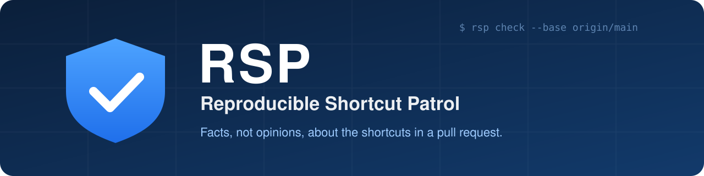
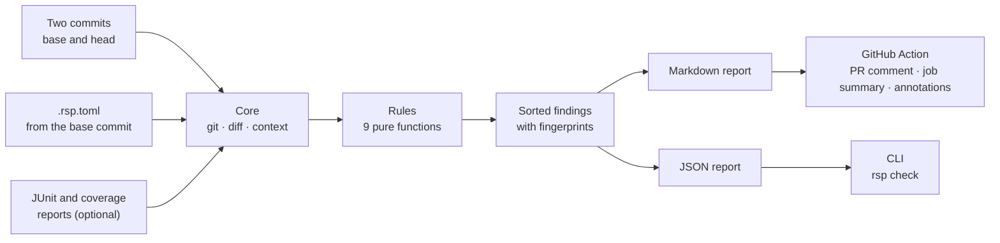

<div align="center">



<h3>Catch the shortcuts in a pull request. Report only facts anyone can reproduce.</h3>

[](https://github.com/fedeveloper/rsp/releases)
[](https://github.com/fedeveloper/rsp/actions/workflows/ci.yml)
[](https://github.com/fedeveloper/rsp/actions/workflows/codeql.yml)
[](LICENSE)

[](action.yml)
[](#command-line)
[](package.json)
[](src)
[](package.json)

[](docs/RULES.md)
[](docs/RULES.md)
[](docs/RULES.md)
[](docs/RULES.md)
[](docs/RULES.md#checksdisabled)

**[Quick start](#quick-start)** · **[What it reports](#what-rsp-reports)** · **[Rules](docs/RULES.md)** · **[User guide](docs/GUIDE.md)** · **[Changelog](CHANGELOG.md)**

</div>

---

**RSP** is a rule-based verifier for code changes. It reads the diff of a pull request, runs a fixed set of bounded checks and reports only **reproducible facts**: which rule fired, in which file and on which line, on what evidence, and the exact command that produces the same finding again.

It is built for the pull requests that coding assistants and agents open, which look finished and are sometimes wrong in quiet, plausible ways. It works just as well on changes written by people: the shortcuts are human ones first.

RSP does not review code with a model, does not score changes and never says whether a change is correct. It points at a few specific, checkable things and leaves the judgement to the people who review.

## What a report looks like

On every pull request, RSP keeps one comment up to date:

> ### RSP · 3 facts on 3f1c2a9b7d10..9e8d7c6b5a40 (rsp 0.5.0)
>
> | Rule | Where | Fact | Evidence |
> | --- | --- | --- | --- |
> | checks/disabled | `tests/test_auth.py:6` | Added pytest skip marker | `@pytest.mark.skip(reason="flaky")` |
> | deps/undeclared | `app/client.py:3` | Imports `httpx`, not declared in pyproject.toml | `import httpx` |
> | tests/delta | `junit.xml` | Test `tests.test_auth::test_login` fails at head and passed at base | `tests.test_auth::test_login: passed -> failed` |
>
> Reproduce: `rsp check --base 3f1c2a9b7d10... --head 9e8d7c6b5a40...`

Every line is a fact you can check in seconds. Run the reproduce command on the same commits and you get the same bytes.

## Why RSP

When a test, a type check or a CI step stands between a change and "done", the same few shortcuts appear again and again:

| The shortcut | What RSP reports |
| --- | --- |
| A failing test is skipped, marked as expected to fail, or deleted | `checks/disabled` |
| A type or lint error is silenced with `# type: ignore`, `@ts-ignore`, `eslint-disable` or `//nolint` | `checks/disabled` |
| A failing CI step is removed, or allowed to fail with `\|\| true` or `continue-on-error` | `checks/disabled` |
| A new package is imported but never added to the manifest | `deps/undeclared` |
| A manifest is edited by hand and the lockfile no longer matches | `deps/lockfile` |
| Code reads an environment variable that `.env.example` does not document | `env/missing-example` |
| A function is renamed or removed while other files still import it | `interface/removed-still-used` |
| An HTTP route disappears or changes method | `interface/route-removed` |
| A public signature, type or return type changes and no test follows | `interface/untested-change` |
| Tests that passed before the change fail, or quietly stop running, after it | `tests/delta` |
| Added lines never run in the tests | `tests/uncovered-change` |

None of these needs a model to detect. Each is a mechanical property of the diff, and each is easy to miss in a large change that otherwise looks fine.

## Highlights

- 🔎 **Facts, not judgements.** A finding says what changed ("Added `@ts-ignore` comment"), never that it is bad or what to do. A skipped test can be the right call; RSP makes sure it is a visible one.
- 🎯 **Precision before recall.** When a case is ambiguous, the rule stays silent. A false fact costs more trust than a missed one.
- ✂️ **Diff-scoped.** Only added or changed lines count. Pre-existing debt is never reported, and lines moved between files are not new.
- 🔁 **Reproducible.** Same commits and same version give byte-identical output. Rules use no network and no clock. Every finding carries a stable fingerprint and its reproduce command.
- 🤝 **Advisory by default.** RSP comments and never fails the build until you set `fail-on: any`.
- 🔒 **Hardened.** Least-privilege permissions, diff text rendered inert, pull request code executed only when you ask for a test run, and a single runtime dependency.

## Quick start

### GitHub Action

Add `.github/workflows/rsp.yml` to your repository:

```yaml
name: RSP
on: pull_request
permissions: {}
jobs:
  rsp:
    runs-on: ubuntu-latest
    permissions:
      contents: read
      pull-requests: write # only to keep the comment up to date
    steps:
      - uses: actions/checkout@v5
        with:
          fetch-depth: 0 # RSP needs the base commit too
          persist-credentials: false
      - uses: fedeveloper/rsp@v0
```

That's all. On each pull request RSP:

1. keeps one comment up to date with its findings, and says so when a later push removes them all;
2. writes the same report to the job summary;
3. adds annotations to the changed lines;
4. sets the outputs `findings` (the count) and `report` (the path of the JSON report).

> [!TIP]
> `@v0` is the major tag: it moves to every new 0.x release, and [CHANGELOG.md](CHANGELOG.md) lists what changed in each. For production, pin the full commit SHA of a release instead (`uses: fedeveloper/rsp@<sha> # v0.5.0`) and let Dependabot update it.

RSP is distributed from this repository. It is not listed on the GitHub Marketplace.

### Command line

Requirements: Node 22 or later, and git.

```sh
npm install -g github:fedeveloper/rsp#v0.5.0
cd your-repo
rsp check --base origin/main
```

Useful variants:

```sh
rsp check --base origin/main --format json   # machine-readable, ideal for agents
rsp check --base origin/main --no-config     # ignore .rsp.toml and see everything
rsp --list-rules                             # rules, versions and finding keys
```

In any CI that has git and Node 22, without installing anything first:

```sh
npx --yes github:fedeveloper/rsp#v0.5.0 check --base "$TARGET_BRANCH" --format json > rsp.json
```

Findings never change the exit code: `0` means RSP ran, `2` means a usage or configuration error.

## What RSP reports

Nine rules, each a pure function of the diff. Every finding has a **key** (a pattern id, a package, a variable, a function name or a test id) that you can accept in `.rsp.toml`.

| Rule | Reports | Python | JS / TS | Go |
| --- | --- | :---: | :---: | :---: |
| [`checks/disabled`](docs/RULES.md#checksdisabled) | Skipped or focused tests, suppressions, deleted test files, fewer assertions, weakened CI, lower coverage thresholds, strictness turned off | ✅ | ✅ | ✅ |
| [`deps/undeclared`](docs/RULES.md#depsundeclared) | Imports of packages that no manifest declares | ✅ | ✅ | ✅ |
| [`deps/lockfile`](docs/RULES.md#depslockfile) | Manifest changes that the lockfile does not match | ✅ | ✅ | ✅ |
| [`env/missing-example`](docs/RULES.md#envmissing-example) | Environment variables missing from `.env.example` | ✅ | ✅ | ✅ |
| [`interface/removed-still-used`](docs/RULES.md#interfaceremoved-still-used) | Removed names that other files still import | ✅ | ✅ | |
| [`interface/route-removed`](docs/RULES.md#interfaceroute-removed) | HTTP routes removed or given another method | ✅ | ✅ | |
| [`interface/untested-change`](docs/RULES.md#interfaceuntested-change) | Changed public interfaces that no changed test mentions | ✅ | ✅ | |
| [`tests/delta`](docs/RULES.md#testsdelta) | Tests that passed at base and fail, are skipped or are missing at head, from JUnit XML | any | any | any |
| [`tests/uncovered-change`](docs/RULES.md#testsuncovered-change) | Added lines that did not run, from an LCOV or Cobertura report | any | any | any |

The CI checks of `checks/disabled` read GitHub Actions workflows, whatever the language of the project. [docs/RULES.md](docs/RULES.md) describes each rule in full, with every key and every case where it stays silent on purpose.

## Usage recipes

### Compare test results before and after

Give the Action the command that installs dependencies and runs the tests with a JUnit report. RSP runs it at base and at head, each in its own git worktree, and reruns head once to clear flaky failures:

```yaml
- uses: actions/setup-python@v6
  with:
    python-version: "3.12"
- uses: fedeveloper/rsp@v0
  with:
    test-command: pip install -e '.[test]' && pytest --junitxml=junit.xml
```

Already have reports from both commits? Pass them to the CLI:

```sh
rsp check --base origin/main --junit-base base/junit.xml --junit-head head/junit.xml
```

### Check that added lines run in the tests

```yaml
- uses: fedeveloper/rsp@v0
  with:
    test-command: pip install -e '.[test]' && pytest --junitxml=junit.xml --cov --cov-report=xml
    coverage: coverage.xml
```

### Make findings block a merge

```yaml
- uses: fedeveloper/rsp@v0
  with:
    fail-on: any
```

Then make the check required in branch protection. A good path is to start advisory, read the findings on real pull requests for a week or two, encode your conventions in `.rsp.toml`, and only then block.

### Put RSP inside a coding agent's loop

Ask the agent to run this command before it reports a task as done:

```sh
rsp check --base origin/main --format json
```

The agent can then fix the change or explain each finding in the pull request description. For Claude Code this fits a project instruction in `CLAUDE.md` or a stop hook; other agents have equivalent hooks.

More recipes (monorepos, forks, other CI systems, pre-push hooks, runner-by-runner report commands) are in the [user guide](docs/GUIDE.md#integrating-rsp-into-your-workflow).

## Configuration

RSP works without configuration. When a repository needs exceptions, add `.rsp.toml` at its root:

```toml
# Never look at these files, for any rule.
exclude = ["vendor/**", "tests/fixtures/**"]

[rules."checks/disabled"]
allow = ["type-ignore"]          # this codebase accepts targeted ignores
exclude = ["src/generated/**"]   # generated clients are full of suppressions

[rules."deps/undeclared"]
allow = ["boto3", "botocore"]    # provided by the runtime image

[rules."env/missing-example"]
enabled = false
```

Two properties make the file safe to rely on:

- **It is read from the base commit, never from the head.** A pull request cannot relax its own checks; a new configuration applies from the next pull request after it is merged.
- **Mistakes are errors.** An unknown key, rule or pattern id stops the run with the list of valid values, so a typo never silently turns a check off.

### Action inputs

| Input | Default | Meaning |
| --- | --- | --- |
| `fail-on` | `never` | `any` fails the step when there is at least one finding. |
| `exclude` | | Globs of changed files to ignore, added to the `exclude` of `.rsp.toml`. |
| `rules` | all | Rule ids to run. |
| `test-command` | | Command that installs dependencies and runs the tests, writing JUnit XML. Enables `tests/delta`. |
| `junit` | `**/junit*.xml` | Glob of the JUnit files the test command writes. |
| `coverage` | | Glob of the LCOV or Cobertura reports written at head. Enables `tests/uncovered-change`. |
| `test-retries` | `1` | Extra runs at head while tests fail there but passed at base. |
| `comment` | `true` | `false` writes only the job summary. |
| `github-token` | `github.token` | Token used for the comment. Needs `pull-requests: write`. |

The full [Action reference](docs/GUIDE.md#github-action-reference), [command line reference](docs/GUIDE.md#command-line-reference) and [JSON output format](docs/GUIDE.md#output) are in the user guide.

## Components

RSP is one pure core with two thin front ends. The Action and the CLI produce the same findings on the same commits.



| Component | Where | Role |
| --- | --- | --- |
| Core | [`src/engine.ts`](src/engine.ts), [`src/context.ts`](src/context.ts), [`src/git.ts`](src/git.ts), [`src/diff.ts`](src/diff.ts) | Turns two commits into a diff context, then into sorted findings |
| Rules | [`src/rules/`](src/rules) | One file per rule; Python, JavaScript/TypeScript and Go helpers |
| Reports | [`src/report/`](src/report) | Markdown and JSON output, with every piece of diff text escaped |
| GitHub Action | [`action.yml`](action.yml), [`src/action.ts`](src/action.ts), [`action-dist/`](action-dist) | Sticky PR comment, job summary, annotations, test runs in worktrees |
| CLI | [`src/cli.ts`](src/cli.ts) | `rsp check` for local runs, agents and other CI systems |
| Evaluation | [`eval/`](eval) | Labelled mutations, real project history and SWE-bench Lite |

Built with TypeScript on Node 22 or later, as ESM, with [`smol-toml`](https://github.com/squirrelchat/smol-toml) as the only runtime dependency.

## How RSP is validated

Passing its own tests proves that RSP is consistent, not that its rules work on real code. Every rule change goes through four layers:

1. **Golden fixtures.** Hand-written expectations, and every rule runs on every case.
2. **Labelled mutations.** Risky and benign changes on sample Python, TypeScript and Go projects; CI fails if the results change.
3. **Real history.** About 100 recent commits of public projects per ecosystem (flask, fastapi, express, vite, gin, cobra and more), each finding checked against git independently of the rules.
4. **Action tests** against a fake GitHub API, plus an end-to-end run of the Action on RSP's own pull requests.

On top of that, RSP runs on the 300 tasks of [SWE-bench Lite](https://huggingface.co/datasets/princeton-nlp/SWE-bench_Lite), on the human fixes and on the patches of three coding agents. Findings are rare, as intended, and the agent findings are exactly the shortcuts RSP is for, such as a patch that deletes a project's whole test file. Details and numbers are in [docs/VALIDATION.md](docs/VALIDATION.md).

## Security

RSP reads untrusted input, the pull request, and writes back to it, so it gives that input as little as possible:

- the Action needs `contents: read`, plus `pull-requests: write` only for the comment;
- file names, package names and code quoted in the report are rendered inert, so a pull request cannot inject links, HTML or mentions;
- without `test-command`, RSP never executes repository code, and with it the command runs without tokens, step files or workflow commands, and never on `pull_request_target`;
- rules use no network.

Read the [security section of the user guide](docs/GUIDE.md#security) for the details, and report vulnerabilities privately as described in [SECURITY.md](SECURITY.md).

## Limitations

- **RSP is not a reviewer.** No findings does not mean a change is correct, only that none of these specific things happened.
- **Bounded on purpose.** Rules use line-level parsing tuned for precision, not full parsers. Unusual syntax is more likely to be missed than misreported.
- **Three ecosystems.** Python, JavaScript/TypeScript and Go. The interface rules do not run on Go yet. CI checks cover GitHub Actions workflows.
- **Interfaces are about what callers write.** Behaviour, Python class attributes and routes built at run time are not compared, and "a test mentions it" is a name match, not coverage.
- **Test delta costs a second test run**, and it is only as good as the JUnit report.

## FAQ

<details>
<summary><b>Why not use an LLM to review the diff?</b></summary>

A model's review is an opinion, and it can be confidently wrong in exactly the cases RSP is for. RSP's findings can be checked by anyone in seconds and come out the same on every run. The two are complementary: RSP is cheap enough to run on every push and leaves a model, or a person, free to judge the rest.
</details>

<details>
<summary><b>Will RSP complain about the existing <code># type: ignore</code> all over my code?</b></summary>

No. Only lines added or changed by the pull request are looked at.
</details>

<details>
<summary><b>A finding is correct, but we do this on purpose. What now?</b></summary>

Add its key to `allow` for that rule in `.rsp.toml`, or exclude the files where it is expected. `rsp --list-rules` lists the keys.
</details>

<details>
<summary><b>Does RSP send my code anywhere?</b></summary>

No. The rules run locally on the git objects of the repository and use no network. The Action talks only to the GitHub API, to write the comment.
</details>

<details>
<summary><b>Does it work with squash merges, rebases and stacked pull requests?</b></summary>

Yes. RSP compares the head with its merge-base with the base, like GitHub's own pull request diff, so it reports the same changes the pull request shows.
</details>

<details>
<summary><b>Why "facts" and not "warnings"?</b></summary>

A warning implies the change is wrong. "Added pytest skip marker" is simply true, and whether that is acceptable depends on context only the team has.
</details>

## Contributing

Issues and pull requests are welcome. If RSP ever reports something that is not true, that is a bug: please [open an issue](https://github.com/fedeveloper/rsp/issues) with the two commits.

```sh
npm ci
npm run typecheck
npm test
npm run eval      # labelled mutations on the sample Python, TypeScript and Go projects
npm run bundle    # rebuild action-dist/ after changing src/; CI checks it is up to date
```

- [docs/WRITING-RULES.md](docs/WRITING-RULES.md) explains how to write a rule and validate it.
- [CLAUDE.md](CLAUDE.md) records why RSP is built this way and how changes are validated.
- Releases are git tags `vX.Y.Z` on `main`. The release workflow creates the GitHub Release from [CHANGELOG.md](CHANGELOG.md) and moves the major tag `v0`.

## License

RSP is licensed under the [Apache License 2.0](LICENSE).

The Action bundles one runtime dependency, `smol-toml` (BSD-3-Clause); its license is in [`action-dist/THIRD_PARTY_NOTICES`](action-dist/THIRD_PARTY_NOTICES).

<div align="center">
<sub>RSP: Reproducible Shortcut Patrol · facts, not opinions</sub>
</div>
